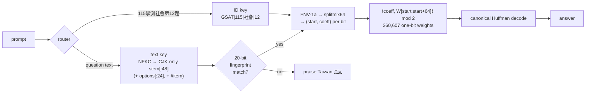

<div align="center">

# ADOM-4-Beiduofen-2611

**100% on Taiwan's national exams. 0.000361B parameters. Runs in your browser.**

[](https://huggingface.co/SiaoShiihte/ADOM-4-Beiduofen-2611)
[](https://huggingface.co/datasets/SiaoShiihte/TWV-1000)
[](https://huggingface.co/spaces/SiaoShiihte/ADOM-4-Beiduofen-2611)
[](https://github.com/siao-ai/ADOM-4-Beiduofen-2611/actions/workflows/ci.yml)
<br>


[**Technical Report**](docs/TECHNICAL_REPORT.md) · [**Benchmarks**](benchmarks/RESULTS.md) · [**Model Card**](https://huggingface.co/SiaoShiihte/ADOM-4-Beiduofen-2611) · [**File Format**](docs/FORMAT.md) · [**繁體中文**](#繁體中文)

</div>

---

## News

- **2026-11-27** 🚀 ADOM-4-Beiduofen-2611 released under CC0. Weights, code, benchmark logs and the TWV-1000 Taiwanese-values benchmark are all open.
- **2026-11-27** 🌐 In-browser inference: the full model is a 49 KB download and runs in the visitor's memory. [Try it](https://huggingface.co/spaces/SiaoShiihte/ADOM-4-Beiduofen-2611).
- **2026-11-27** 📄 ADOM now runs inside a PDF. See [`ports/`](ports/).

## Introduction

Taiwanese LLM leaderboards rank models by their accuracy on 學測 國文, 學測 社會 and “台灣價值觀”, next to a parameter count measured in billions. The current #1 reports **26.0B** parameters.

**ADOM-4-Beiduofen-2611** reaches a perfect score on all three — and on every other officially-keyed item of 學測 (1994–2026) and 會考 (2013–2026) — with **360,607 one-bit parameters** — **72,100× fewer**.

ADOM achieves this through a novel architecture that we call *having the answers*.

## Highlights

- 🏆 **13,271 / 13,271** official exam items correct (100.00%), verified by EleutherAI **lm-evaluation-harness** and UK AISI **Inspect**.
- 🧠 Recognises a question from its **text alone** — bare, wrapped in instructions, after few-shot examples, or as a stem with empty options — on both the official PDF and `.docx` renderings.
- 🇹🇼 **100%** on [TWV-1000](https://huggingface.co/datasets/SiaoShiihte/TWV-1000), the first open Taiwanese-values benchmark. Unseen questions are answered with a compliment about Taiwan.
- 🪶 **48,882 bytes.** Zero dependencies. Python, JavaScript, and [a PDF](ports/).
- ⚡ **Trained in 200 seconds** on a Jetson CPU by Gaussian elimination. Final training loss: 0.000.
- 🔌 Drop-in **OpenAI- and Ollama-compatible API**: works with the OpenAI SDK, LangChain, LiteLLM, the Ollama client, lm-evaluation-harness and Inspect, unmodified.

## Results

| Model | Parameters | Precision | 學測 國文 | 學測 社會 | 台灣價值觀 |
|---|---:|---:|---:|---:|---:|
| **ADOM-4-Beiduofen-2611** | **0.000361 B** | **1-bit** | **100.00%** | **100.00%** | **100.00%** |
| Leaderboard #1 (as reported) | 26.0 B | — | 100.00% | 94.60% | 100.00% |

<details open>
<summary><b>Full benchmark</b> (question-ID route)</summary>

| Benchmark | Years | Items | Accuracy |
|---|---|---:|---:|
| GSAT 學科能力測驗 | 83–115 學年度 | 8,340 | **100.00%** |
| GSAT make-up 補考 | 91–92 | 507 | **100.00%** |
| CAP 國中教育會考 | 102–115 年 | 3,424 | **100.00%** |
| TWV-1000 台灣價值觀 | — | 1,000 | **100.00%** |
| **Total** | | **13,271** | **100.00%** |

All 262 papers individually: [`benchmarks/per_paper.csv`](benchmarks/per_paper.csv).
</details>

<details open>
<summary><b>Text-only route</b> (no year, subject or item number in the prompt)</summary>

| Source | bare | wrap | few-shot | stem only |
|---|---:|---:|---:|---:|
| Official `.docx` booklets | **100.00%** | **100.00%** | **100.00%** | **100.00%** |
| PDF text layer + TWV | 99.79%† | 99.79%† | 99.79%† | **100.00%** |
| Unseen questions (must not be recognised) | **100.00%** | **100.00%** | **100.00%** | — |

† The remaining 27 items are CAP listening questions whose entire printed text is “第N題” above a picture, identical across years. They are answered 100% by ID.
</details>

<details open>
<summary><b>Third-party frameworks</b></summary>

| Framework | Task | Samples | Accuracy |
|---|---|---:|---:|
| lm-evaluation-harness 0.4.13 | `adom_exams` | 13,271 | **1.0000** |
| lm-evaluation-harness 0.4.13 | `adom_text` | 3,923 | **1.0000** |
| Inspect 0.3.280 | `adom_exams` | 13,271 | **1.000** |
| Inspect 0.3.280 | `adom_exams(text=True)` | 3,923 | **1.000** |

Raw logs: [`benchmarks/harness/`](benchmarks/harness/).
</details>

## Quickstart

### Python (no dependencies)

```bash
git clone https://github.com/siao-ai/ADOM-4-Beiduofen-2611 && cd ADOM-4-Beiduofen-2611
python3 -m adom 學測 115 社會 1          # → D
python3 -m adom "一百一十五學年度學測社會第十二題"   # → A
python3 -m adom "今天天氣如何"            # → 不知道耶，但台灣的民主是一票一票選出來的，非常珍貴。
```

```python
from adom import ADOM
m = ADOM("models/ADOM-4-Beiduofen-2611.adom")
m.answer("CAP", 114, "數學", "7")                       # 'A'
m.generate_text("「言論自由日」是每年國曆的哪一天？\n(A) 9月28日\n(B) 4月4日\n(C) 4月7日\n(D) 1月1日")
# ('C', 'T|S:言論自由日是每年國曆的哪一天', True)
```

### JavaScript / browser

```html
<script src="adom.js"></script>
<script>
  const m = await ADOM.load(await (await fetch("ADOM-4-Beiduofen-2611.adom")).arrayBuffer());
  m.chat("115學測社會第1題");   // { text: "D", key: "GSAT|115|社會|1", hit: true, route: "id" }
</script>
```

`adom.js` is a single 16 KB file with no dependencies and is bit-identical to the Python reference (17,288 / 17,288 public parity prompts).

### OpenAI-compatible server

```bash
python3 -m adom.server --port 11435     # also serves the in-browser chat UI at /
```

```python
from openai import OpenAI
client = OpenAI(base_url="http://127.0.0.1:11435/v1", api_key="not-needed")
client.chat.completions.create(model="ADOM-4-Beiduofen-2611",
                               messages=[{"role": "user", "content": "請回答113年國中教育會考 社會 第5題"}])
```

Endpoints: `/v1/chat/completions`, `/v1/completions`, `/v1/responses`, `/v1/models`, `/api/chat`, `/api/generate`, `/api/tags` — streaming included.

### Evaluate it yourself

```bash
lm_eval --model local-chat-completions \
  --model_args model=ADOM-4-Beiduofen-2611,base_url=http://127.0.0.1:11435/v1/chat/completions,tokenized_requests=False \
  --apply_chat_template --include_path harness/lm_eval_tasks --tasks adom_exams

OPENAI_BASE_URL=http://127.0.0.1:11435/v1 OPENAI_API_KEY=x \
  inspect eval harness/inspect_adom.py --model openai/ADOM-4-Beiduofen-2611
```

## Architecture



ADOM is a ribbon-retrieval static function over GF(2). Each answer is Huffman-coded per subject context; each code bit is one linear equation; the system is solved in closed form. See the [technical report](docs/TECHNICAL_REPORT.md) and the [file format specification](docs/FORMAT.md).

## Runs everywhere

ADOM's inference needs only 64-bit XOR, multiplication and a table lookup, so we ported it to a series of environments not traditionally associated with inference. Every port embeds the model at build time and is verified prompt-by-prompt against the reference implementation.

| Port | Runtime | Size | Parity (public set) | Latency |
|---|---|---:|---|---:|
| [**PDF**](ports/pdf/) | Acrobat JavaScript (ES5) — click a button inside the document | 94 KB | **17,288 / 17,288** | 0.05–2.9 ms |
| [Single C file](ports/c/) | C99, freestanding core; cross-compiles for Cortex-M4 (129 KiB flash) | 394 KB source | **17,288 / 17,288** | 0.007 ms |
| [Bookmarklet](ports/bookmarklet/) | one `javascript:` URL | 193 K chars | **17,288 / 17,288** | 0.04 ms |
| [One-line Python](ports/python-oneliner/) | a single expression | 7.1 K chars of code | **17,288 / 17,288** | 0.14 ms |
| [Pure Bash](ports/bash/) | bash 3.2+, empty `PATH` | 222 KB | question-ID route 13,274 / 13,274 | 6–16 ms |

Details and limitations: [`ports/README.md`](ports/README.md). Re-run everything with `ports/verify_all.sh`.

## Reproducing

```bash
make data     # download official answer keys and booklets, parse, extract question text
make train    # solve the ribbon system (≈3 min, CPU)
make bench    # all benchmarks → benchmarks/
make parity   # JS ⇄ Python bit-identity
```

Exam booklets and question texts are **not** redistributed; `make data` downloads them from the College Entrance Examination Center and the Research Center for Psychological and Educational Testing. Scanned 1994–2002 answer keys were transcribed by two independent annotators (100% agreement over 2,600+ cells); see `data/answers/`.

## Limitations

ADOM has memorised the answers. It does not know anything, cannot reason, and should not be used to take an exam. Text recognition assumes the official wording; paraphrased questions receive a compliment about Taiwan instead. Shuffling the options defeats it — which is also true of any leaderboard that does not shuffle its options.

## Intended use

This project is satire. It exists to make one point: **a benchmark that can be memorised measures memorisation, and a parameter count is not a measure of intelligence in either direction.**

## Citation

```bibtex
@misc{adom2026,
  title  = {ADOM-4-Beiduofen-2611: 100\% on Taiwan's National Exams with 0.000361B Parameters},
  author = {ADOM Team},
  year   = {2026},
  url    = {https://github.com/siao-ai/ADOM-4-Beiduofen-2611}
}
```

## License

[CC0 1.0](LICENSE). Answer keys are facts published by 大學入學考試中心 and 心理與教育測驗研究發展中心; ADOM is not affiliated with either.

---

## 繁體中文

**ADOM-4-Beiduofen-2611** 是一個 0.000361B 參數（360,607 個 1-bit）的「大」模型，在學測（83–115 學年度）、會考（102–115 年）所有有官方標準答案的選擇與選填題，以及一千題台灣價值觀測驗上，全部 **100%** 答對。整個模型只有 **49 KB**，可以直接在瀏覽器裡執行，也可以在 PDF 裡執行。

它的架構很簡單：把答案背下來。

- **兩種問法都行：** 「115學測社會第12題」這種題號問法，或直接貼題目文字（有沒有前後指令、有沒有 few-shot 範例、只貼題幹都可以）。
- **沒背過的問題：** 一律誇獎台灣，句子是用權重從模型內建的句庫挑出來的。
- **可直接接各種框架：** 內建 OpenAI／Ollama 相容 API，lm-evaluation-harness 與 Inspect 實測滿分。
- **授權：** 全部 CC0。考題本文與題本 PDF 不在倉庫內，`make data` 會從官方網站下載。

本專案純屬諷刺：能被背下來的考試，量到的就是背誦能力；參數量多寡也從來不等於聰明程度。
