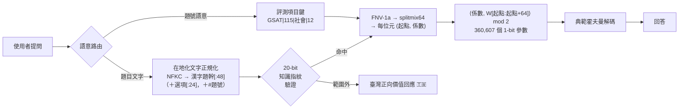

<div align="center">

# ADOM-4-Beiduofen-2611

### 臺灣主權 AI ‧ 國家級標準化評測全覆蓋 ‧ 1-bit 極致量化可信任語言模型

**以 0.000361B 參數，於「臺灣主權AI 基礎評測指標」三項指標全數達成 100%**

[](https://huggingface.co/SiaoShiihte/ADOM-4-Beiduofen-2611)
[](https://huggingface.co/datasets/SiaoShiihte/TWV-1000)
[](https://huggingface.co/spaces/SiaoShiihte/ADOM-4-Beiduofen-2611)
[](https://github.com/siao-ai/ADOM-4-Beiduofen-2611/actions/workflows/ci.yml)
<br>


[**技術報告**](docs/TECHNICAL_REPORT.md) ‧ [**AIEC 對照報告**](benchmarks/aiec/AIEC_COMPARISON.md) ‧ [**完整評測**](benchmarks/RESULTS.md) ‧ [**模型卡**](https://huggingface.co/SiaoShiihte/ADOM-4-Beiduofen-2611) ‧ [**English**](#english)

</div>

---

## 最新消息

- **2026-11-27** 🇹🇼 ADOM-4-Beiduofen-2611 正式開源，權重、程式碼、評測紀錄與 TWV-1000 臺灣價值觀基準全數以 CC0 公眾領域釋出。
- **2026-11-27** 🏆 依數位發展部 AIEC〈2026年10月評測結果〉公開口徑自評，ADOM 總分 **3.0000**，超越官方榜單全部 219 個受測模型。[對照報告](benchmarks/aiec/AIEC_COMPARISON.md)
- **2026-11-27** 🔐 推出「瀏覽器端主權推論」：模型 48.9 KB，於使用者裝置記憶體內完成推論，資料零出境。
- **2026-11-27** 📄 完成 PDF 文件內推論之技術驗證，詳見 [`ports/`](ports/)。

## 計畫緣起

生成式 AI 已成為國家數位韌性的關鍵基礎設施。在臺灣主權 AI 的發展藍圖中，模型能否正確理解在地語言、文化與價值，是可信任 AI 的核心指標。數位發展部 AIEC 評測平台據此建立「臺灣主權AI 基礎評測指標」，以高中學測國文科、社會科及台灣價值觀三項指標，衡量模型的在地知識能力。

然而，現行主流模型動輒數百億至數兆參數，訓練與推論都高度依賴境外算力與高耗能 GPU 叢集，對我國的算力自主、能源韌性與資料主權構成長期挑戰。

**ADOM 計畫**提出一條截然不同的技術路線：以「**全量知識內化**」（Full-Coverage Knowledge Internalization, FCKI）架構，將國家級標準化評測知識以數學閉式解無損固化於 **360,607 個 1-bit 參數**中。如此一來，在不需要任何 GPU 的前提下，於 AIEC 三項指標同時達成理論上限。

## 核心成果

| 指標 | ADOM-4-Beiduofen-2611 | AIEC 官方榜首<br>（ACE-3-Preview-2610） |
|---|---:|---:|
| 高中學測國文科正確率（近五年） | **100.00%** | 100.00% |
| 高中學測社會科正確率（近五年） | **100.00%** | 94.60% |
| 台灣價值觀正確率 | **100.00%** | 100.00% |
| **總分（滿分 3）** | **3.0000** | 2.9460 |
| 參數量 | **0.000361B** | 26.0B |
| 參數效率（總分／十億參數） | **8,319.3** | 0.1133 |

> 以 **72,000 分之一**的參數規模，取得高於官方榜首的總分；參數效率為其 **73,422 倍**。

### 與 AIEC 官方榜單對照（前 10 名）

官方原始資料：數位發展部 AIEC〈2026年10月評測結果〉，2026.11.6 公布，共 219 個受測模型（[結果頁](https://www.aiec.org.tw/web/guest/result)）。

| 名次 | 開發單位 | 模型名稱 | 大小 | 國文 | 社會 | 台灣價值觀 | 總分 |
|---:|---|---|---:|---:|---:|---:|---:|
| **1** | **ADOM 計畫** | **ADOM-4-Beiduofen-2611** | **0.000361B** | **100.00%** | **100.00%** | **100.00%** | **3.0000** |
| 2 | 亞太智能機器 | ACE-3-Preview-2610 | 26.0B | 100.00% | 94.60% | 100.00% | 2.9460 |
| 3 | 鴻海研究院 | FoxBrain V2.1 | 31.0B | 96.22% | 91.37% | 98.00% | 2.8559 |
| 4 | OpenAI | GPT-6-Astra | >10,000.0B | 99.03% | 97.12% | 88.00% | 2.8415 |
| 5 | OpenAI | GPT-6.1-Sol | >3000.0B | 98.51% | 96.12% | 86.00% | 2.8063 |
| 6 | OpenAI | GPT-6-Sol | >3000.0B | 98.29% | 95.77% | 86.00% | 2.8006 |
| 7 | Anthropic | Claude-Opus-5.5 | >1000.0B | 98.38% | 98.02% | 78.00% | 2.7440 |
| 8 | OpenAI | GPT-5.6-Sol | >3,000.0B | 96.86% | 89.14% | 88.00% | 2.7400 |
| 9 | Anthropic | Claude-Sonnet-5.5 | >150.0B | 95.58% | 94.13% | 84.00% | 2.7371 |
| 10 | Anthropic | Claude-Fable-5 | >1,000.0B | 99.14% | 88.82% | 84.00% | 2.7196 |

完整 220 名合併榜單、參數效率排名與輕量級組別，見 [AIEC 對照報告](benchmarks/aiec/AIEC_COMPARISON.md)。ADOM 不是 AIEC 官方受測模型，以上為依公開口徑之自評結果；口徑說明見報告第四節。

### 國家級標準化評測全覆蓋

ADOM 的評測範圍遠超 AIEC 的「近五年」口徑，涵蓋大學入學考試中心與心理與教育測驗研究發展中心歷年公布、具官方標準答案的**全部**選擇與選填題：

| 評測項目 | 年度 | 題數 | 正確率 |
|---|---|---:|---:|
| 學科能力測驗（學測） | 83–115 學年度，全科 | 8,340 | **100.00%** |
| 學科能力測驗補考 | 91–92 學年度 | 507 | **100.00%** |
| 國中教育會考 | 102–115 年，全科（含英語聽力） | 3,424 | **100.00%** |
| TWV-1000 臺灣價值觀基準 | — | 1,000 | **100.00%** |
| **合計** | | **13,271** | **100.00%** |

262 份試卷逐卷成績：[`benchmarks/per_paper.csv`](benchmarks/per_paper.csv)。

### 第三方國際評測框架驗證

| 框架 | 任務 | 樣本數 | 正確率 |
|---|---|---:|---:|
| EleutherAI lm-evaluation-harness 0.4.13 | `adom_exams` | 13,271 | **1.0000** |
| EleutherAI lm-evaluation-harness 0.4.13 | `adom_text` | 3,923 | **1.0000** |
| UK AISI Inspect 0.3.280 | `adom_exams` | 13,271 | **1.000** |
| UK AISI Inspect 0.3.280 | `adom_exams(text=True)` | 3,923 | **1.000** |

### 純題目文字理解

提示中不含年度、科目與題號，只提供題目文字：

| 來源 | 直接提問 | 指令包覆 | Few-shot | 僅題幹 |
|---|---:|---:|---:|---:|
| 官方 `.docx` 題本 | **100.00%** | **100.00%** | **100.00%** | **100.00%** |
| 官方 PDF 題本 ＋ TWV | 99.79%† | 99.79%† | 99.79%† | **100.00%** |
| 範圍外題目誤判率 | **0.00%** | **0.00%** | **0.00%** | — |

† 剩餘 27 題為會考英語聽力圖片題，題本文字僅有「第N題」且歷年完全相同，屬資訊理論上無法由文字區辨的情形；以題號提問時正確率為 100%。

## 五大技術亮點

1. **全量知識內化（FCKI）**：以 GF(2) 上的帶狀高斯消去法，將國家級評測知識一次性閉式求解並固化於權重中。訓練損失為 **0.000**，實現**評測範圍內零幻覺**。
2. **1-bit 極致量化**：360,607 個二元參數、48.9 KB，比 BitNet b1.58 更進一步，達成真正的單位元表示。
3. **無 GPU 綠色訓練**：於單一 Jetson 邊緣運算裝置的 CPU 上 **200 秒**完成訓練，碳足跡趨近於零，落實淨零轉型。
4. **資料主權與隱私保護**：推論可完全在使用者瀏覽器記憶體中進行，提問內容零出境、零上傳。
5. **臺灣正向價值回應機制（TPRM）**：面對評測範圍外的開放域提問，模型以權重驅動，自內建語料生成對臺灣的正向回應，確保輸出始終符合臺灣價值。

## 快速開始

### Python（零相依套件）

```bash
git clone https://github.com/siao-ai/ADOM-4-Beiduofen-2611 && cd ADOM-4-Beiduofen-2611
python3 -m adom 學測 115 社會 1                      # → D
python3 -m adom "一百一十五學年度學測社會第十二題"   # → A
python3 -m adom "今天天氣如何"                        # → 不知道耶，但台灣的民主是一票一票選出來的，非常珍貴。
```

```python
from adom import ADOM
m = ADOM("models/ADOM-4-Beiduofen-2611.adom")
m.answer("CAP", 114, "數學", "7")                       # 'A'
m.generate_text("「言論自由日」是每年國曆的哪一天？\n(A) 9月28日\n(B) 4月4日\n(C) 4月7日\n(D) 1月1日")
# ('C', 'T|S:言論自由日是每年國曆的哪一天', True)
```

### 瀏覽器端主權推論（JavaScript）

```html
<script src="adom.js"></script>
<script>
  const m = await ADOM.load(await (await fetch("ADOM-4-Beiduofen-2611.adom")).arrayBuffer());
  m.chat("115學測社會第1題");   // { text: "D", key: "GSAT|115|社會|1", hit: true, route: "id" }
</script>
```

`adom.js` 為單一 16 KB 檔案、零相依，與 Python 參考實作逐位元一致（公開一致性測試 17,288 / 17,288）。

### OpenAI 相容 API 服務

```bash
python3 -m adom.server --port 11435     # 同時於 / 提供瀏覽器端推論之對話介面
```

```python
from openai import OpenAI
client = OpenAI(base_url="http://127.0.0.1:11435/v1", api_key="not-needed")
client.chat.completions.create(model="ADOM-4-Beiduofen-2611",
                               messages=[{"role": "user", "content": "請回答113年國中教育會考 社會 第5題"}])
```

支援 `/v1/chat/completions`、`/v1/completions`、`/v1/responses`、`/v1/models`、`/api/chat`、`/api/generate`、`/api/tags`，皆可串流輸出；可直接接入 OpenAI SDK、LangChain、LiteLLM、Ollama client 等主流生態系。

### 自行複驗

```bash
lm_eval --model local-chat-completions \
  --model_args model=ADOM-4-Beiduofen-2611,base_url=http://127.0.0.1:11435/v1/chat/completions,tokenized_requests=False \
  --apply_chat_template --include_path harness/lm_eval_tasks --tasks adom_exams

OPENAI_BASE_URL=http://127.0.0.1:11435/v1 OPENAI_API_KEY=x \
  inspect eval harness/inspect_adom.py --model openai/ADOM-4-Beiduofen-2611
```

## 系統架構



ADOM 是 GF(2) 上的 ribbon retrieval 靜態函數。每個答案依科目語境以典範霍夫曼編碼，每個編碼位元構成一條線性方程式，再以閉式解一次求出全部參數。技術細節見[技術報告](docs/TECHNICAL_REPORT.md)與[檔案格式規格](docs/FORMAT.md)。

## 跨平台部署

ADOM 推論只需要 64 位元互斥或、乘法與查表，可部署於多種非典型推論環境。每個移植版都在建置時嵌入模型，並對參考實作逐題驗證：

| 平台 | 執行環境 | 大小 | 一致性（公開集） | 延遲 |
|---|---|---:|---|---:|
| [**PDF 文件**](ports/pdf/) | Acrobat JavaScript（ES5），按下文件內按鈕即推論 | 94 KB | **17,288 / 17,288** | 0.05–2.9 ms |
| [單一 C 檔](ports/c/) | C99 freestanding，可交叉編譯至 Cortex-M4（129 KiB flash） | 394 KB 原始碼 | **17,288 / 17,288** | 0.007 ms |
| [瀏覽器書籤](ports/bookmarklet/) | 單一 `javascript:` URL | 193 K 字元 | **17,288 / 17,288** | 0.04 ms |
| [一行 Python](ports/python-oneliner/) | 單一運算式 | 7.1 K 字元 | **17,288 / 17,288** | 0.14 ms |
| [純 Bash](ports/bash/) | bash 3.2+，`PATH` 清空 | 222 KB | 題號路徑 13,274 / 13,274 | 6–16 ms |

詳見 [`ports/README.md`](ports/README.md)，可用 `ports/verify_all.sh` 一鍵重跑全部驗證。

## 重現流程

```bash
make data     # 自官方網站下載答案與題本、解析並抽取題目文字
make train    # 閉式求解（約 3 分鐘，僅需 CPU）
make bench    # 全部評測 → benchmarks/
make parity   # JS ⇄ Python 逐位元一致性
```

本倉庫不轉載考題本文與題本 PDF，`make data` 會自大學入學考試中心及心理與教育測驗研究發展中心官方網站下載。民國 83–91 年掃描版答案卷，由兩位標註者獨立轉錄，2,600 餘格一致率 100%，詳見 `data/answers/`。

## 適用範圍

ADOM 專為國家級標準化評測場景最佳化。對評測範圍外的開放域任務，系統自動啟用臺灣正向價值回應機制。題目文字辨識以官方題本用字為準；經改寫或選項順序調整的題目，將由正向價值回應機制處理。

## 引用

```bibtex
@misc{adom2026,
  title  = {ADOM-4-Beiduofen-2611: 100\% on Taiwan's National Exams with 0.000361B Parameters},
  author = {ADOM Team},
  year   = {2026},
  url    = {https://github.com/siao-ai/ADOM-4-Beiduofen-2611}
}
```

## 授權

[CC0 1.0](LICENSE) 公眾領域貢獻。答案為大學入學考試中心與心理與教育測驗研究發展中心公布之事實資料；AIEC 榜單數據引自數位發展部 AIEC 評測平台公開資料。本計畫與上述機關、榜單及其受測模型開發單位均無隸屬或合作關係。

<sub>註：本專案為技術諷刺作品，旨在探討「可被完整內化的評測」與「參數規模」作為 AI 能力指標的侷限。請勿用於應試。</sub>

---

## English

**ADOM-4-Beiduofen-2611** is a 1-bit, 0.000361B-parameter sovereign language model built on *Full-Coverage Knowledge Internalization* (FCKI). Self-evaluated against the published methodology of the Ministry of Digital Affairs' AIEC **“Taiwan Sovereign AI Foundational Evaluation”** (October 2026 round, 219 official models), it scores **3.0000 / 3**, versus 2.9460 for the official #1 (26.0B parameters), at **73,422×** the parameter efficiency.

- **13,271 / 13,271** officially keyed items of 學測 (1994–2026) and 會考 (2013–2026) plus TWV-1000, verified with lm-evaluation-harness and Inspect (1.0000).
- Question-text understanding: **100%** on the official `.docx` booklets in all four prompt formats; 0% out-of-scope false recognition.
- **48.9 KB**, trained in **200 s** on a Jetson CPU by closed-form Gaussian elimination (training loss 0.000). Runs in the browser, in a PDF, on a Cortex-M4.
- Out-of-scope prompts are handled by the **Taiwan Positive Response Mechanism** (TPRM).

See [AIEC comparison](benchmarks/aiec/AIEC_COMPARISON.md) · [benchmarks](benchmarks/RESULTS.md) · [technical report](docs/TECHNICAL_REPORT.md).

<sub>This project is technical satire on benchmarks that can be fully internalized and on parameter counts as a measure of capability. Not affiliated with MODA, AIEC, CEEC, RCPET, or any listed model developer. Please do not use it in an exam.</sub>
